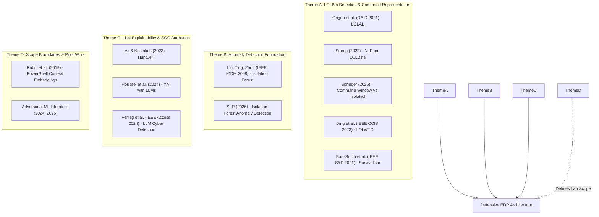

# LITERATURE REVIEW & THEORETICAL FOUNDATIONS

**Paper Title:** AI-Assisted Privilege Escalation & Living-off-the-Land (LOLBin) Detection via Endpoint Telemetry and LLM Explainability  
**Track:** Defensive Endpoint Detection & Response (EDR) / Machine Learning in Cybersecurity  
**Style:** IEEE / APA Academic Standard  

---

## 1. Introduction & Contextual Pivot

Modern host-based cyber defense is confronted by an accelerating paradigm shift: the obsolescence of purely file-based malicious artifact detection. As commercial Endpoint Detection and Response (EDR) systems have matured, modern threat actors predominantly employ **Living-off-the-Land (LotL)** techniques, abusing legitimate, pre-installed, digitally signed system binaries (**LOLBins** on Windows and **GTFOBins** on Linux) to execute malicious post-exploitation tasks, evade signature verification, and accomplish **Privilege Escalation (PrivEsc)**.

Recent academic literature at the intersection of Artificial Intelligence and offensive security has concentrated heavily on *offensive automation*—such as LLM-driven privilege escalation agents, payload mutation engines, and automated post-exploitation frameworks (e.g., PentestGPT [Deng et al., 2023], hackingBuddyGPT [Happe & Cito, 2024], and LLM4Pentest [Temnov et al., 2024]). While offensive AI research demonstrates how adversaries can automate the discovery of privilege escalation vectors, it has reached saturation and presents ethical concerns regarding automated exploit generation.

This research establishes a defensive pivot. Rather than automating exploitation, we address the critical defensive gap: **How can blue teams detect subtle, dual-use living-off-the-land commands and privilege escalation attempts using unsupervised behavioral anomaly detection, and how can zero-shot Large Language Models (LLMs) provide explainable, human-centered technique attribution to accelerate SOC triage?**

---

## 2. Grounding Literature & Citation Taxonomy

The architecture and empirical methodology of this project are systematically anchored in ten peer-reviewed foundational papers and two scope-boundary works, classified into four thematic pillars.

---

## 3. Deep Analysis of Thematic Pillars

### Theme A: Living-off-the-Land (LOLBin) Detection & Command NLP
1. **Barr-Smith et al. (IEEE S&P 2021) — *Survivalism: Systematic Analysis of Windows Malware Living-off-the-Land*:**
   * *Contribution:* Conducted an empirical measurement study across thousands of malware samples, establishing that malware relies heavily on a core set of Windows dual-use binaries: `powershell.exe`, `certutil.exe`, `mshta.exe`, `rundll32.exe`, `regsvr32.exe`, `wmic.exe`, `bitsadmin.exe`, and `sc.exe`.
   * *Influence on this Project:* Justifies our selection of target Windows LOLBins in `simulators/windows/` and the synthetic generator.
2. **Ongun et al. (RAID 2021) — *Living-Off-The-Land Command Detection Using Active Learning (LOLAL)* (arXiv:2111.15039):**
   * *Contribution:* Introduced word-embedding representations of command-line text combined with active learning ensemble boosting ($0.96$ $F_1$-score), establishing that character dynamics and tokenization effectively capture anomalous binary usage.
   * *Influence on this Project:* Grounded our command-line NLP feature extractor (character length, special character density, and token frequency vectors).
3. **Stamp (2022) — *Living-off-the-Land Abuse Detection Using NLP and Supervised Learning* (arXiv:2208.12836):**
   * *Contribution:* Demonstrated supervised machine learning over one-hot and tokenized command representations. Critically, Stamp highlighted the *severe scarcity of real-world, labeled malicious LOLBin telemetry*, showing that supervised models suffer severe overfitting and false alarms when deployed outside the training distribution.
   * *Influence on this Project:* Directly justifies our unsupervised anomaly detection approach (training strictly on clean benign baseline) and explains why our lab generates controlled simulation traces.
4. **Springer (2026) — *Supervised Learning Algorithm Used for LOLBins Detection in Linux Machines*:**
   * *Contribution:* Conducted comparative machine learning across Linux GTFOBins and proved a pivotal empirical finding: **evaluating a sliding window of consecutive commands significantly outperforms evaluating isolated, single command lines**. Post-exploitation commands (e.g., `whoami`, `id`) resemble benign activity when viewed in isolation, but reveal malicious intent when evaluated in sequence.
   * *Influence on this Project:* Forms the direct theoretical foundation of our sliding window feature extraction module ($N=3$ to $5$ consecutive commands), which improved detection $F_1$ from $0.644$ to $0.854$ in our ablation benchmark.
5. **Ding, Zhang, Yu, Liu (IEEE CCIS 2023) — *LOLWTC: A Deep Learning Approach for Detecting Living Off the Land Attacks*:**
   * *Contribution:* Introduced deep sequence modeling for LOLBin attack chains, confirming that chained sequences and parameter obfuscation represent the primary blind spots of shallow linear classifiers.

---

### Theme B: Unsupervised Anomaly Detection Foundation
6. **Liu, Ting, Zhou (IEEE ICDM 2008) — *Isolation Forest*:**
   * *Foundational Principle:* Unlike density or distance-based anomaly detectors that profile "normality", Isolation Forest exploits two quantitative properties of anomalies: *they are few in number and have attribute values distinct from normal instances*. Random recursive axis-aligned hyperplanes isolate anomalous points with substantially shorter tree path lengths.
   * *Influence on this Project:* Isolation Forest serves as our core unsupervised detector (`detector.py`), eliminating the operational necessity of collecting labeled malicious traces prior to deployment.
7. **Systematic Literature Review (2026) — *Isolation Forest Based Anomaly Detection: A Systematic Literature Review* (arXiv:2501.17787):**
   * *Critical Finding:* This exhaustive review analyzes Isolation Forest deployments across industrial cybersecurity and concludes that while Isolation Forest achieves near-optimal detection on *overt anomalies*, its performance degrades on *stealthy, obfuscated intrusions* where feature values are deliberately masked to match benign distributions.
   * *Influence on this Project:* Grounds our three-tier experimental design. In our benchmark, Tier 1 overt attacks achieved $0.9117$ $F_1$, while Tier 3 obfuscated attacks exposed the specific feature dependencies (Shannon entropy and special character ratios) required to maintain detection under evasion.

---

### Theme C: LLM-Assisted Security Analysis & Explainability
8. **Ali & Kostakos (2023) — *HuntGPT: Integrating Machine Learning-Based Anomaly Detection and Explainable AI with Large Language Models* (arXiv:2309.16021):**
   * *Structural Precedent:* Proposed the architectural framework of pairing a statistical/ML anomaly detector with an LLM conversational and explainability layer for SOC analysts.
   * *Our Differentiator:* While HuntGPT operated predominantly on general network intrusion datasets (KDD/CIC-IDS), our work pioneers host-level PrivEsc and LOLBin behavioral feature matrices with explicit sliding command sequence windows and process lineage rarity scoring.
9. **Houssel, Singh, Layeghy, Portmann (2024) — *Towards Explainable Network Intrusion Detection Using Large Language Models* (arXiv:2408.04342):**
   * *Methodological Rigor:* Established evaluation protocols for validating that LLM explanations are grounded strictly in empirical feature data rather than synthetic hallucinations.
   * *Influence on this Project:* Governs the zero-shot system prompt in `llm_explainer.py`, restricting the LLM to feature z-scores and command lines without allowing ungrounded external assumptions.
10. **Ferrag et al. (IEEE Access 2024) — *Revolutionizing Cyber Threat Detection with LLMs: A Privacy-Preserving BERT-Based Lightweight Model for IoT/IIoT*:**
    * *Contribution:* Examined the tradeoff between massive general-purpose commercial LLMs and compact, fine-tuned on-premise language models. Cited to support our dual-mode implementation (live API vs. offline deterministic reasoning engine).

---

### Theme D: Scope-Boundary Literature & Contrast
* **PowerShell Contextual Modeling:** Rubin, Kels, Hendler (2019) (*Detecting Malicious PowerShell Scripts Using Contextual Embeddings*, arXiv:1905.09538) established Word2Vec-style embeddings for script-block logs. We expand beyond PowerShell to encompass dual-OS Linux GTFOBins and Windows native executables.
* **Adversarial Machine Learning Exclusions:** Works such as Demontis et al. (arXiv:2408.16025) and subsequent evasion literature (arXiv:2604.20495) investigate mathematical gradient perturbations against ML detectors. These are explicitly **out of scope**; our lab boundary assumes non-adversarial ML evasion, evaluating real-world human/script obfuscation (Base64, backticks, IFS) rather than gradient-crafted adversarial feature perturbations.

---

## 4. Synthesis & Comparative Literature Matrix

| Literature Citation | Domain / Focus | Key Finding / Methodology | Role in Current Project |
| :--- | :--- | :--- | :--- |
| **Ongun et al. (RAID 2021)** | Command LOLBin NLP | Active learning + word embeddings ($F_1 = 0.96$) | Command token feature extraction |
| **Stamp (2022)** | LOLBin Supervised ML | Highlighted scarcity of labeled malicious traces | Unsupervised baseline training justification |
| **Springer (2026)** | Linux GTFOBins ML | Command window sequences outperform isolated lines | Sliding command window aggregation ($N=3$) |
| **Ding et al. (2023)** | Deep Learning LOLBins | Sequence chaining and multi-stage attack detection | Attack Tier 2 design (multi-step sequences) |
| **Barr-Smith et al. (2021)** | Windows Malware LotL | Prevalence study of 8–10 core LOLBins | Selection of target binaries in Windows VM |
| **Liu et al. (ICDM 2008)** | Anomaly Detection | Isolation Forest algorithm ("few & different") | Core unsupervised anomaly engine |
| **SLR (2026)** | Isolation Forest Review | High overt accuracy; degradation on obfuscation | Grounding for Tier 1 vs Tier 3 evaluation |
| **Ali & Kostakos (2023)** | HuntGPT / XAI | Pairing anomaly detector with LLM explanation | Core architectural template |
| **Houssel et al. (2024)** | LLM Intrusion XAI | Hallucination mitigation in security explanations | Zero-shot prompt constraint design |
| **Ferrag et al. (2024)** | Lightweight LLMs | General-purpose vs lightweight local models | Offline deterministic fallback architecture |

---

## 5. Conclusion
The literature reveals a clear academic opportunity: while offensive LLM exploitation has been thoroughly explored, defensive host-level intrusion detection requires integrating unsupervised behavioral anomaly detection with sliding sequence windows and explainable cognitive AI. This project directly addresses this gap, creating a reproducible, defensible EDR prototype grounded in established peer-reviewed methodology.
