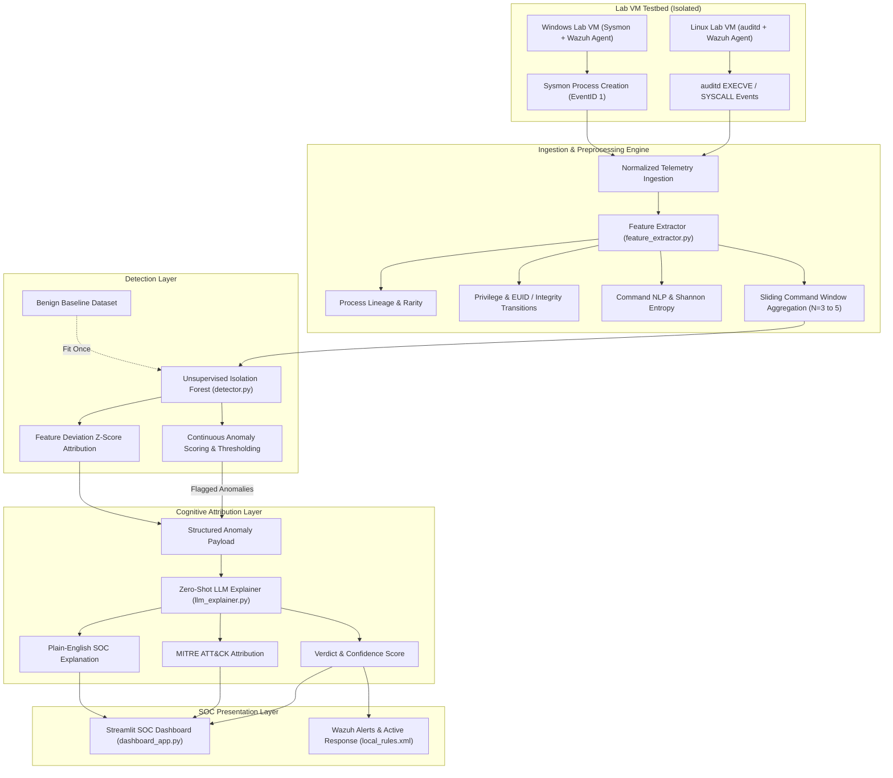

# SYSTEM ARCHITECTURE SPECIFICATION

**Project Title:** AI-Assisted Privilege Escalation & Living-off-the-Land (LOLBin) Attempt Detection via Endpoint Telemetry and LLM Explainability  
**Document Version:** 1.0.0  
**Target Audience:** Security Architects, SOC Engineers, and Academic Reviewers  

---

## 1. High-Level Architecture Overview

The detection and explainability pipeline is designed as an end-to-end, multi-stage detection engineering architecture. It ingests raw endpoint telemetry from heterogeneous operating systems (Linux and Windows), extracts temporal and behavioral feature spaces, flags statistical outliers via an unsupervised Isolation Forest engine, and synthesizes actionable plain-English verdicts using a zero-shot LLM Tier-3 SOC analyst persona.



---

## 2. Component Deconstruction

### 2.1 Telemetry Collection & Normalization Layer
* **Linux:** Uses Linux Auditing Subsystem (`auditd`) rules tracking `execve` syscalls, EUID switches, and sensitive file modifications (`/etc/sudoers`, `/etc/shadow`). Wazuh agent forwards audit logs.
* **Windows:** Uses Microsoft Sysinternals Sysmon configured with schema filtering Event ID 1 (Process Creation with complete command-line strings and parent hashes) and Event ID 11 (File Create for sensitive directories like `C:\Windows\Temp`, `SAM`).
* **Normalized Schema Format:**
```json
{
  "event_id": "UUID-v4",
  "timestamp": "ISO-8601-UTC",
  "source": "sysmon | auditd | wazuh",
  "os_type": "linux | windows",
  "host": "hostname",
  "session_id": "session_identifier",
  "process_name": "binary_basename",
  "process_path": "/full/path/to/binary",
  "parent_process_name": "parent_basename",
  "parent_process_path": "/full/path/to/parent",
  "command_line": "raw_command_string",
  "user": "username",
  "uid": 1000,
  "euid": 0,
  "integrity_level": "Medium | High | System",
  "file_touches": ["/touched/file/paths"]
}
```

---

### 2.2 Feature Extraction Engine (`feature_extractor.py`)
Post-exploitation behaviors—especially Living-off-the-Land abuse—cannot be accurately modeled by analyzing single commands in isolation. The feature extraction engine computes four distinct feature dimensions:

1. **Process Lineage Rarity:**
   - Evaluates the rarity of the `Parent Process -> Child Process` transition relative to the benign baseline corpus.
   - Frequency score:
     $$\text{Pair Rarity} = 1.0 - \frac{\text{Count}(\text{Parent} \to \text{Child})}{\text{Total Baseline Events} + 1}$$
2. **Privilege & Access Transition:**
   - Detects discrepancies between real UID and effective UID ($\text{UID} \neq \text{EUID}$ and $\text{EUID} = 0$), Windows integrity elevation (`Medium` $\to$ `High` or `System`), and sensitive file touches.
3. **Command-Line NLP & Statistical Dynamics:**
   - **Shannon Entropy:** Detects character randomness, base64 payloads, and obfuscation:
     $$H(X) = -\sum_{i=1}^{n} P(x_i) \log_2 P(x_i)$$
   - **Special Character Ratio:** Ratio of shell metacharacters (`;`, `|`, `&`, `$`, `` ` ``, `\`, `"`, `'`) to length.
   - **Sensitive Token Density:** Keywords mapped to GTFOBins and Windows LOLBins (`NOPASSWD`, `-exec`, `checkpoint`, `pty.spawn`, `urlcache`, `bypass`, `IEX`, `sekurlsa`).
4. **Sliding Command Window Aggregation (Springer 2026):**
   - For every event in a session, aggregates temporal statistics across the preceding $N=3$ commands:
     - Window average and maximum command length
     - Window average and maximum Shannon entropy
     - Maximum privilege elevation observed within the window
     - Cumulative sensitive file touch count
     - Transition pair rarity across the sequence.

---

### 2.3 Unsupervised Anomaly Detection Engine (`detector.py`)
* **Algorithm:** Isolation Forest (Liu, Ting, Zhou, IEEE ICDM 2008).
* **Rationale:** Anomalies are "few and different". Unlike supervised models that require exhaustive datasets of every emerging PrivEsc exploit, Isolation Forest constructs random partitioning trees. Anomalous feature vectors are isolated near the root of the trees (short average path length).
* **Contamination Hyperparameter:** Set to $\nu = 0.015$ to enforce a low False Positive Rate (FPR $\le 2\%$) in production environments.
* **Feature Attribution (Z-Scores):** For every flagged event, the engine computes feature deviations against benign baseline moments:
  $$Z_i = \frac{x_i - \mu_{\text{benign}, i}}{\sigma_{\text{benign}, i}}$$
  The top-$k$ highest deviations are packaged into the anomaly payload passed to the cognitive attribution layer.

---

### 2.4 Zero-Shot LLM Attribution Layer (`llm_explainer.py`)
Rather than expecting tier-1 SOC analysts to decipher raw z-score matrices, the LLM layer provides cognitive explainability (grounded in Ali & Kostakos, 2023 [HuntGPT] and Houssel et al., 2024):
* **Strict Prompt Contract:** The LLM operates strictly as a Tier-3 SOC Analyst.
* **Hallucination Prevention:** The prompt restricts reasoning strictly to the provided command line, process lineage, and feature deviations.
* **Deterministic Offline Fallback:** If API credentials or network routes are unavailable, a deterministic MITRE ATT&CK heuristic engine generates matching verdicts, ensuring CI/CD pipeline reliability.

---

### 2.5 Visualization & SIEM Integration Layer
* **SOC Console (`dashboard_app.py`):** Real-time Streamlit console visualizing live telemetry events, anomaly distributions, feature deviation radar charts, and LLM explanation cards.
* **Wazuh Decoders & Rules (`local_rules.xml`):** Custom XML rule mappings alerting on Linux GTFOBins (Rules 100100–100102) and Windows LOLBins (Rules 100201–100207) with MITRE ATT&CK tagging.
