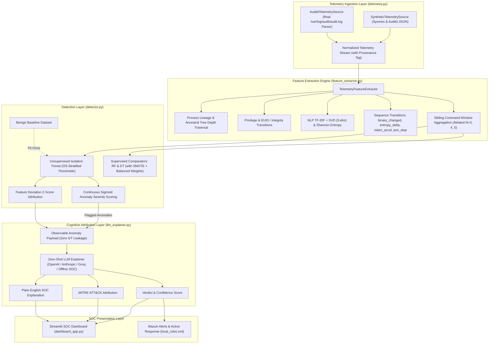

# SYSTEM ARCHITECTURE SPECIFICATION

**Project Title:** AI-Assisted Privilege Escalation & Living-off-the-Land (LOLBin) Attempt Detection via Endpoint Telemetry and LLM Explainability  
**Document Version:** 2.0.0 (Post-Scientific Audit Verified)  
**Target Audience:** Security Architects, SOC Engineers, and Academic Reviewers  

---

## 1. High-Level Architecture Overview

The detection and explainability pipeline is designed as an end-to-end, multi-stage detection engineering architecture. It ingests endpoint telemetry via an extensible adapter layer (`TelemetrySource`), processes raw execution records into sequence-aware feature spaces, flags statistical outliers via an unsupervised Isolation Forest engine calibrated per operating system, and synthesizes actionable plain-English verdicts using a zero-shot LLM Tier-3 SOC analyst persona.



---

## 2. Component Deconstruction

### 2.1 Telemetry Ingestion & Adapter Layer (`pipeline/telemetry.py`)
To ensure scientific integrity and eliminate coupling to synthetic data artifacts, ingestion is decoupled via an Abstract Base Class:
```python
class TelemetrySource(ABC):
    @abstractmethod
    def events(self) -> Iterator[Dict[str, Any]]: ...
    @property
    @abstractmethod
    def provenance(self) -> str: ...
```

Two concrete implementations are provided:
1. **`SyntheticTelemetrySource`:** Ingests pre-generated lab JSON datasets, tagging records with `source_provenance="synthetic"`.
2. **`AuditdTelemetrySource`:** Ingests and correlates raw production Linux auditd logs (e.g., from `ausearch -k exec -i` or `/var/log/audit/audit.log`).
   - Correlates multi-line records (`SYSCALL`, `EXECVE`, `PATH`, `CWD`, `PROCTITLE`) using the shared audit event ID (`msg=audit(epoch:ID)`).
   - Reconstructs full command lines from ordered argument keys (`a0`, `a1`, `a2`, ...).
   - Extracts touched files from `PATH` records (`name=...`).
   - Emits standardized events with `source_provenance="real_auditd"`.

#### Normalized Event Schema:
```json
{
  "event_id": "UUID-v4",
  "audit_msg_id": "auditd_id_optional",
  "timestamp": "ISO-8601-UTC",
  "source": "sysmon | auditd",
  "source_provenance": "synthetic | real_auditd",
  "os_type": "linux | windows",
  "host": "hostname",
  "session_id": "session_identifier",
  "process_name": "binary_basename",
  "process_path": "/full/path/to/binary",
  "parent_process_name": "parent_basename",
  "parent_process_path": "/full/path/to/parent",
  "parent_process_id": 1000,
  "command_line": "raw_command_string",
  "cwd": "/working/directory",
  "user": "username",
  "uid": 1000,
  "gid": 1000,
  "euid": 0,
  "integrity_level": "None | Medium | High | System",
  "file_touches": ["/touched/file/paths"],
  "label": "benign | malicious | unknown",
  "tier": 0,
  "technique": "Technique Name",
  "mitre_technique_id": "T1548.003",
  "raw_event": "raw_log_string"
}
```

---

## 3. Feature Extraction Engine (`pipeline/feature_extractor.py`)

Post-exploitation behaviors—especially Living-off-the-Land abuse—cannot be accurately modeled by analyzing single commands in isolation. The feature extraction engine computes five distinct feature dimensions:

### 3.1 Process Lineage & Real Ancestral Tree Depth
- **Lineage Anomaly Score:**
  $$P(\text{Parent} \mid \text{Child}) = \frac{\text{Count}(\text{Parent} \to \text{Child})}{\text{Count}(\text{Child})}$$
  $$\text{LineageAnomalyScore} = 1.0 - P(\text{Parent} \mid \text{Child})$$
  Evaluated against benign baseline counts. Legitimate system spawns (`explorer.exe` or `svchost.exe` spawning `rundll32.exe`) score $\approx 0.0$, whereas interactive adversary shells (`cmd.exe` or `powershell.exe` spawning them) score $1.0$.
- **Ancestral Tree Depth:** Traverses the session PID-to-PPID parent graph dynamically up to the session root, computing the true process ancestry depth ($1$ to $16$).
- **Process & Pair Rarity:** Baseline frequency ratios against total observed events.

### 3.2 Continuous NLP Command-Line Representations (Ongun et al. RAID 2021)
- **Continuous TF-IDF Embeddings:** Sub-word and token n-gram (`ngram_range=(1, 2)`) vectorizer fitted strictly on clean benign commands, reduced to 5 continuous components via `TruncatedSVD(n_components=5, random_state=42)`.
- **Shannon Character Entropy:**
  $$H(X) = -\sum_{i=1}^{n} P(x_i) \log_2 P(x_i)$$
  Quantifies character unpredictability to detect Base64 encoding, hex escaping, and variable substitution.
- **Special Character Ratio:** Ratio of shell metacharacters (`;`, `|`, `&`, `$`, `` ` ``, `\`, `"`, `'`) to command length.
- **Continuous Behavioral LOLBin Indicators:**
  - `remote_or_untrusted_path_density`: Density of external URI schemes (`http://`, `https://`, `ftp://`, `\\\\`) and untrusted writable paths (`\\Users\\Public\\`, `\\Windows\\Temp\\`, `\\AppData\\Local\\Temp\\`, `/tmp/`, `/dev/shm/`).
  - `inline_scriptlet_protocol_density`: Frequency of COM scriptlet handlers (`javascript:`, `vbscript:`, `scrobj.dll`, `runhtmlapplication`, `-urlcache`, `-split`, `-decode`).

### 3.3 Sequence-Aware Ordered Transitions (Springer 2026)
Unlike simple window averages, sequence transition features capture dynamic relationships *between* consecutive steps:
- `entropy_delta`: Step-to-step jump in Shannon entropy ($H_t - H_{t-1}$).
- `token_acceleration`: First derivative of suspicious token occurrences ($\text{hits}_t - \text{hits}_{t-1}$).
- `binary_changed`: Boolean indicator ($1.0$ vs. $0.0$) tracking whether the executing binary altered relative to the previous step in the same session.
- `priv_escalated_in_window`: Boolean indicator ($1.0$ vs. $0.0$) capturing if the session stepped from unprivileged ($\text{EUID}=1000$ / `Medium`) to elevated ($\text{EUID}=0$ / `High`).
- `inter_event_delta_ms`: Millisecond delay between consecutive commands in the session.
- `command_burst_frequency`: Inverse timing metric ($1000 / \Delta t$) identifying rapid automated script bursts.

### 3.4 Sliding Command Window Aggregations
Maintains a sliding deque of size $N$ ($N=3$ default, with $N=4$ and $N=5$ ablated):
- Window maximum and average entropy
- Window maximum and average command length
- Window maximum privilege transition and lineage anomaly
- Window cumulative sensitive file touches and untrusted path densities

---

## 4. Anomaly Detection Engine (`pipeline/detector.py`)

### 4.1 Unsupervised Isolation Forest (Liu et al. ICDM 2008)
- **Principle:** Anomalies are "few and different", requiring fewer random hyperplanes to isolate.
- **Contamination Parameter:** Set to $\nu = 0.025$.
- **OS-Stratified Threshold Calibration:** Calibrates independent decision thresholds for Linux ($\text{percentile} = \min(1.35 \times \nu, 0.035)$) and Windows ($\text{percentile} = \nu$). This prevents Linux UID transitions from dominating global variance and masking user-level Windows LOLBin abuse.
- **Calibrated Sigmoid Scoring:**
  $$z = \frac{\tau_{\text{OS}} - s_{\text{raw}}}{\sigma_{\text{OS}}}$$
  $$\text{AnomalyScore} = \frac{1}{1 + e^{-1.8 z}}$$

### 4.2 Supervised Benchmarks with SMOTE (Stamp 2022)
To prove the hypothesis that supervised classifiers overfit to seen attacks and fail to generalize on novel LOLBin variations:
- Implements `RandomForestClassifier` and `DecisionTreeClassifier`.
- Incorporates Synthetic Minority Over-sampling Technique (`SMOTE(k_neighbors=5, random_state=42)`) combined with `class_weight="balanced"` to resolve the extreme class imbalance between massive benign baselines and scarce attack samples.

---

## 5. Cognitive Attribution Layer (`pipeline/llm_explainer.py`)

### 5.1 Strict Zero-Shot Schema Contract
The LLM explainer acts as a Tier-3 SOC Analyst receiving strictly observable endpoint telemetry:
```json
{
  "event_id": "UUID-v4",
  "timestamp": "ISO-8601",
  "os_type": "linux | windows",
  "process_name": "binary_name",
  "parent_process_name": "parent_name",
  "command_line": "command_string",
  "session_id": "session_id",
  "anomaly_score": 0.88,
  "top_feature_deviations": [
    {"feature": "lineage_anomaly_score", "observed_value": 1.0, "z_score": 4.12}
  ],
  "sliding_window_commands": ["cmd1", "cmd2", "cmd3"]
}
```
**Zero Ground-Truth Exposure:** Labels (`label`, `tier`, `technique`, `mitre_technique_id`) are stripped before constructing the payload.

### 5.2 Deterministic Offline Fallback Engine
When API keys (`OPENAI_API_KEY`, `ANTHROPIC_API_KEY`, `GROQ_API_KEY`) are omitted, an offline SOC analyst reasoning engine evaluates command syntax, environment-variable aliasing (`T1027.010`), multi-step discovery chains (`T1059 / T1087`), and GTFOBins/LOLBins rules deterministically, ensuring reproducible CI testing.

---

## 6. Scientific Limitations & Telemetry Provenance Disclosure

1. **Synthetic Telemetry Lab Boundary:** Primary benchmarking relies on synthetic telemetry simulating Linux `auditd` and Windows Sysmon event schemas.
2. **Production Generalization Disclaimer:** Enterprise production endpoints introduce high background noise (developer tooling, enterprise deployment agents, uncurated cron jobs). Generalization to real environments requires validation against live endpoints using `AuditdTelemetrySource`.
3. **Curated Technique Distribution:** The benchmark incorporates a uniform distribution across 10 target binaries across 3 complexity tiers. Real-world telemetry exhibits a heavy-tailed distribution where benign administrative utilities outnumber malicious actions by several orders of magnitude.
